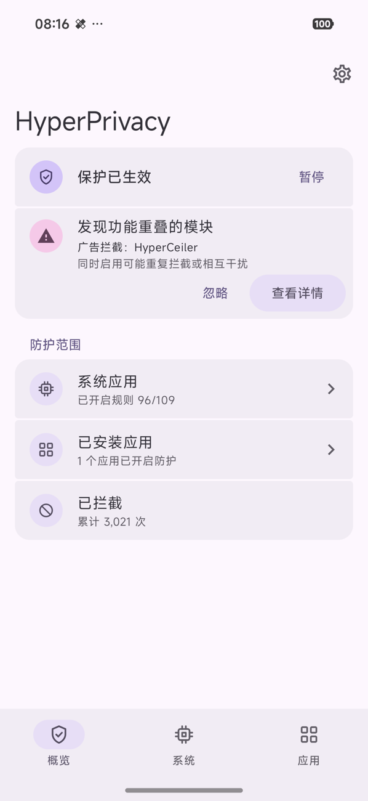
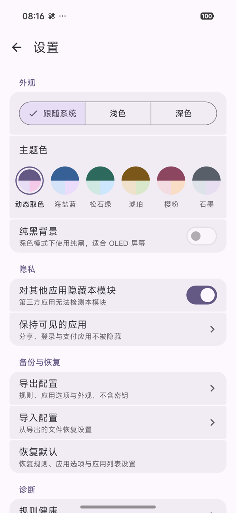

# HyperPrivacy

**给小米 HyperOS 做的隐私上报与广告屏蔽模块（LSPosed）。拦系统应用的隐私上报，也保护你自己装的应用，不影响任何厂商服务。**

[](https://github.com/12dora/hyper-privacy/actions/workflows/ci.yml)
[](https://github.com/12dora/hyper-privacy/releases)


[](LICENSE)

在设置里关掉「用户体验计划」，系统应用就停止上报了吗？并没有。HyperPrivacy 在一台 HyperOS 4 真机上把 318 个系统应用挨个排查了一遍，将能找到的统计、日志、广告、设备标识和应用列表上报通道整理成 109 条规则，帮你一键拦住。而日常离不开的应用商店、推送、云同步、查找设备、天气和系统更新，全部照常工作。

从 0.4 开始，它的保护范围也延伸到了你自己安装的应用：离线识别每个应用里内置的追踪 SDK，想保护哪个就开哪个，广告 SDK 还能不看域名、按来源直接拦住。

<p align="center">
  
  
  
  
</p>

<p align="center"><sub>底部三栏：概览 / 系统 / 应用；设置入口在概览页右上角。截图依次为概览、系统、应用、设置。</sub></p>

## 为什么需要它

在真机上做完一轮抓包和反编译之后，我们看到了这些实际情况：

- **系统开关并不是真正的隐私边界。** 明明已经关掉了「用户体验计划」和「个性化广告」，系统分析服务还是会连接统计服务器和第三方广告、内容服务器，甚至在后台读取精确位置。
- **102 个系统应用里都内置了 OneTrack 统计 SDK。** 它的上报地址被编码后藏了起来，普通的域名扫描根本查不到。它还会上传已安装应用列表，新版本甚至多了一条经云消息服务的原生上报通道。
- **负一屏会上传完整的应用列表。** 手机里每个应用的包名、版本和安装时间都会被上传；之后每次安装或卸载应用，它也会跟着增量上报。
- **预装的第三方输入法塞进了多套统计。** 设备指纹、性能监控、崩溃上报、行为统计一应俱全，平时打字的时候就在上报。
- **正常服务和隐私上报常常混在同一个服务器上。** 比如安全中心的同一个域名，既承载正常的隐私授权，也负责月度数据上传。如果按域名一刀切，正常服务也会误伤，所以必须精确到接口路径来区分。
- **自己装的应用也一样。** 一个应用里往往同时塞着好几家广告、统计和设备识别 SDK，它们之间还会互相关联你的设备，光靠系统权限管不住。

如果你对具体的排查方法、取证依据和覆盖情况感兴趣，可以查看 [隐私上报面与规则覆盖](docs/privacy-surface.md)；想先搞清楚「数据到底是怎么被收集的」，可以读 [应用是怎么收集隐私数据的](docs/collection-techniques.md)。

## 功能

**系统应用防护**

- **109 条规则，覆盖 121 个系统应用**：按用途整理为统计分析、日志诊断、广告、设备标识、应用列表、个人数据 6 类，一目了然。
- **默认配置足够省心**：109 条规则里 96 条默认开启，装好即用。其中通讯录、短信原文、应用列表、设备指纹、短信链接这类高风险泄露，即使拦截会带来一点副作用也默认阻止，并在规则里写明影响；另外 13 条拦了会影响安全、支付、账号、定位等功能的规则默认关闭，需要时可以手动开启。
- **隐藏设备标识**：第三方应用读取 OAID / VAID / AAID 时只会拿到全零结果（符合行业规范的「限制广告追踪」值），小米自家服务不受影响。

**第三方应用防护（0.4 新增）**

- **保护你安装的应用**：离线识别每个已安装应用内置的追踪 SDK，特征库收录 208 个 SDK（其中广告类 69 个）；每个应用、每个 SDK 都有单独的开关。
- **按来源拦截广告 SDK**：不依赖域名，SDK 换域名、换包名或以插件形式加载时同样有效。
- **按应用的隐私增强**：隔离 DRM 设备号、强制使用系统 DNS，另有默认关闭的「随机化硬件指纹」与「保护传感器数据」。
- **在系统层隐藏标识和应用列表**：向第三方应用隐藏账号与设备标识类设置项，并可让指定应用看不到你装了哪些其他应用。
- **模块自我隐藏**：默认对第三方应用隐藏本模块，避免被检测。

**日常使用**

- **一键暂停**：首页可暂停全部拦截 15 分钟、1 小时或直到手动恢复，到点自动恢复。
- **配置备份**：设置里可把规则开关、应用选项、应用列表设置和外观导出为文件，换机或重装后导入；不含模块密钥和任何状态数据。
- **冲突与重启提示**：与其他功能重叠的模块、模块更新后需要重启，首页都会明确告诉你。
- **规则健康检测**：系统更新后如果厂商改了接口，会自动提示「已失效」「待复核」或「长期无拦截」；在其他机型上本来就不存在的 SDK 会显示为「不适用」，不会误报。
- **诊断模式**：记录系统应用的网络请求，标出疑似新的上报通道；支持一键导出不含个人信息的诊断报告，方便反馈；开启后还会统计各拦截点的耗时，关闭时没有额外开销。
- **即时生效**：切换规则和应用开关后立刻作用于正在运行的应用，不需要为了试一条规则反复重启；只有系统层的功能和模块更新后需要重启一次。
- **自身零联网权限**：应用本身没有申请联网权限，不收集、也不上传任何数据。
- **三栏界面与顺眼的外观**：概览、系统、应用三个页面各管一摊；支持浅色、深色模式与跟随系统，提供动态取色与 5 套内置配色。

## 第三方应用防护

内置规则只覆盖系统应用。对于你自己安装的应用，HyperPrivacy 提供按应用开启的追踪防护，在「应用」页里完成：

- **离线识别**：在 HyperPrivacy 自身进程内读取安装包，按 SDK 特征识别其中的追踪 SDK（广告、统计、崩溃上报、设备识别等）。不加载、不执行目标应用的任何代码，也不需要联网；结果按应用版本缓存，应用更新后自动重新识别。部分加固应用的代码经过加密，可能无法识别。
- **按需开启**：为某个应用开启防护后，模块会请求将它加入 LSPosed 作用域，你在 LSPosed 的通知里确认一下，应用重新启动后生效。内置的系统应用规则不受影响。
- **逐项可调**：每个已识别的 SDK 都有单独的开关。推送送达、登录、地图等 SDK 正常功能用到的域名始终保留；拦截后可能影响登录、支付验证或应用内更新的 SDK（主要是设备识别类）默认不拦截，共 15 个，需要时可以手动开启。
- **按来源拦截广告 SDK**：广告 SDK 的网络请求和广告页面，按发起它们的代码来源拦截，而不是只认域名。特征库里不认识、但看起来像广告组件的代码会单独列出，默认不拦，由你决定。
- **按应用隐私增强**：
  - 隔离 DRM 设备号：同一台手机上，每个应用拿到的 DRM 设备号都不一样，不能再借它互相关联。默认开启，不影响音视频播放。
  - 强制系统 DNS：阻止应用绕过系统 DNS 去问第三方解析服务，让域名规则看得见真实的目的地。默认开启。
  - 随机化硬件指纹：让各应用读到的传感器参数、存储分区标识、电池循环次数这类无需权限的硬件特征互不相同，传感器数据与机型信息保持不变。默认关闭，可按应用开启。
  - 保护传感器数据：降低该应用读到的运动、磁场、气压、环境光传感器与电池读数的精度，运动类传感器事件频率最高 50 Hz，系统自身的自动亮度与旋转不受影响。默认关闭，可按应用开启。
- **隐藏已安装应用**：可让某个应用看不到你装的其他应用；常用的社交、分享、登录和支付应用默认仍可见，开启「严格模式」后一并隐藏。

SDK 特征库位于 `data/trackers.json`，依据各 SDK 厂商的公开文档、公开发布的 SDK 制品以及真机上的安装包分析整理而成，每条都附有来源说明。

## 系统层隐藏与模块自隐藏

除了按应用拦截，HyperPrivacy 还在系统层面做了两件事，都只面向第三方应用：

- **隐藏标识类设置项**：厂商把一些账号、设备标识和「已安装应用列表」写进了任何应用都能读取的系统设置里。模块让第三方应用读不到这些条目，系统自己的组件不受影响。
- **隐藏已安装应用**：对你选中的应用，让它看不到其他第三方应用，无论是逐个枚举、挨个探测还是通过意图查询。
- **隐藏模块自身**：默认开启，第三方应用无法检测到 HyperPrivacy 的存在；桌面、LSPosed 管理器和被拦截的系统应用不受影响。开关在设置的「隐私」分组里，切换后即时生效。

这部分功能工作在系统层，首次启用或更新模块后需要重启一次手机。

## 系统已有功能，我们不重复做

HyperOS 自带的这些功能已经做得不错，HyperPrivacy 不重复建设，建议你同时用起来：

- 剪贴板读取提示
- 应用联网控制
- 自启动与关联启动管理
- 广告标识（OAID）重置
- 模糊位置
- 空白通行证（对应用返回空白信息）
- 应用行为记录
- 应用锁与应用分身

我们专注于系统没有覆盖的部分：系统应用自己的上报通道、第三方应用里内置的追踪 SDK，以及跨应用的设备关联。

## 与其他方案的对比

平时大家可能会用 hosts、VPN 防火墙或其他模块来拦广告和上报。不同方案各有取舍，这里放在一起供你参考：

| | hosts / DNS 拦截 | VPN 防火墙 | 常见 Xposed 隐私模块 | **HyperPrivacy** |
|---|---|---|---|---|
| 拦截精度 | 整个域名 | 整个应用 | 视实现而定 | 精确到域名或接口路径，同一服务器上的服务照常工作 |
| HTTPDNS / 写死 IP 直连 | 拦不住 | 只能给整个应用断网 | 多数拦不住 | 按 TLS 握手中的域名（SNI）拦截，并可强制应用使用系统 DNS |
| 应用自带网络栈（自带网络库、内嵌网页） | 拦不住 | 只能给整个应用断网 | 多数拦不住 | 在 HTTP 客户端层与 WebView 请求层拦截 |
| 原生代码直接联网 | 部分可拦 | 可拦 | 拦不住 | 纯上报应用由内核防火墙按 uid 直接断网 |
| 广告 SDK 更换域名 | 要不断追加 | 要不断追加 | 视实现而定 | 按代码来源拦截，不依赖域名 |
| 占用 VPN 通道 | 部分方案占用 | 占用，会与代理冲突 | 不占用 | 不占用，可与代理工具共存 |
| 运行时需要 root | 视方案而定 | 不需要 | 常常需要 | 不需要，只需 LSPosed |
| 配置是否暴露给其他应用 | — | — | 有的写进全局设置，任何应用可读 | 经 LSPosed 私有通道传递，不外泄；模块本身也对第三方应用隐藏 |
| 每条规则有取证依据 | 否 | 否 | 少见 | 是，附抓包、反编译或 dex 证据 |
| 接口变化能否察觉 | 否 | 否 | 否 | 支持规则健康检测 |

## 工作原理

每条规则都对应一个具体的上报通道。HyperPrivacy 会根据通道特点，选用最精确、也不会误伤正常服务的拦截层：

| 拦截层 | 作用位置 | 用途 |
|---|---|---|
| 内核防火墙 | 系统服务 | 对拥有独立 uid 的纯上报应用（系统分析服务、系统广告服务）整体断网，原生代码也无法绕过 |
| DNS 解析 | 目标应用进程 | 拦住上报域名的解析请求 |
| TLS 握手 | 目标应用进程 | 按握手时的域名（SNI）拦截，覆盖 HTTPDNS 和写死 IP 的直连 |
| HTTP 客户端 | 目标应用进程 | 按「域名 + 路径」精准拦截，覆盖系统自带与应用自带的 HTTP 网络库以及内嵌网页 |
| SDK 方法 | 目标应用进程 | 直接停用统计 SDK 的上报接口 |
| 设备标识 | 安全中心进程 | 向第三方应用返回全零的 OAID / VAID / AAID |
| 系统层隐藏 | 系统服务 | 向第三方应用隐藏标识类设置项与已安装应用，并隐藏模块自身 |
| 应用内防护 | 你选中的第三方应用进程 | 拦截已识别 SDK 的上报，按来源拦截广告，隔离设备号，强制系统 DNS |

所有拦截都遵循「失败即放行」原则：万一模块自身出错，也只会默认放行，目标应用照常运行，不会因此崩溃。

## 安装

整个配置过程很简单，只需四步：

1. **准备环境**：确保系统为 HyperOS（Android 14 及以上），并已安装 LSPosed（libxposed API 101 及以上，如 LSPosed 2.x）。
2. **安装模块**：前往 [Releases](https://github.com/12dora/hyper-privacy/releases) 下载最新的 APK 并安装。
3. **勾选作用域**：打开 LSPosed，启用 HyperPrivacy，在模块页右上角菜单中选择「勾选推荐」。
4. **重启生效**：重启手机后打开 HyperPrivacy，看到「保护已生效」就说明已经在工作了。

想保护自己装的应用？打开「应用」页，选中应用开启防护，在 LSPosed 的通知里确认，再把该应用重新打开就行。从旧版本更新也请重启一次手机。

## 常见问题

**为什么 LSPosed 里可以勾选更多应用了？**
第三方应用防护需要在运行时把你选中的应用加入作用域，因此模块不再固定作用域。「勾选推荐」仍只勾选内置规则涉及的系统应用；没有开启防护的其他应用，即使被手动勾选，模块也不会做任何拦截。

**之后才安装的小米应用（如米家、小米健康）也会被保护吗？**
会，但需要你点一下。LSPosed 不会自动把新装的应用加入作用域，HyperPrivacy 首页会提示「N 个应用未启用防护」，点「启用」后在 LSPosed 的通知里确认即可；应用重新启动后生效。规则列表只显示本机已安装应用相关的规则。

**开启第三方应用防护，会不会影响登录、支付或推送？**
尽量不会。推送、登录、地图等功能用到的域名始终保留；拦截后可能需要额外验证或影响应用内更新的 SDK（主要是设备识别类）默认不拦截，并在列表里标明影响。万一某个应用出了问题，在「应用」页关掉防护，或在首页暂停全部拦截就能恢复，重新启动该应用即可。

**会影响推送、云同步、应用更新吗？**
放心，不会。账号、推送、云服务、系统与应用更新、天气、定位查询、云输入这些日常服务的端点都不在拦截范围内，排查文档里也逐项列出了保留的服务。

**为什么有些规则默认关闭？**
现在默认关闭的只剩 12 条。它们和具体功能共用接口，拦掉之后会影响安全、支付、账号或定位，比如云查杀需要上传应用特征，支付收银台、查找设备的定位也可能受牵连；还有几条是你主动参与的项目，比如问题反馈和地震监测志愿者。所以我们把它们默认关上，并在规则里写明影响，把选择权交给你。

**拦掉通讯录、短信这类数据，会不会也有副作用？**
会有一点，所以每条规则都写明了影响，比如「云端通讯录词库失效」「无法提交流量纠错」。但这类数据泄露的代价更大，所以我们选择默认阻止；觉得影响不划算，随时可以在规则详情里单独关掉。

**为什么需要重启？更新之后也要吗？**
隐藏标识类设置项、隐藏已安装应用、模块自隐藏这些功能工作在系统层，系统服务只在开机时加载模块，所以首次启用和更新模块之后都需要重启一次；首页会在需要时给出提示。规则开关和应用防护的开关则不用重启。

**我在第三方应用商店或安装器里搜不到 HyperPrivacy，更新不了？**
这是「对其他应用隐藏本模块」的预期效果：默认开启时，第三方应用商店、安装器和更新工具也看不到本模块，自然检测不到新版本。需要这样更新时，先到「设置 → 隐私」里把它关掉，更新完再打开即可，切换即时生效，不用重启。也可以直接从 [Releases](https://github.com/12dora/hyper-privacy/releases) 下载安装。

**提示「已失效」「待复核」「不适用」是什么意思？**
- 「已失效」：这条规则之前在本机生效过，现在找不到拦截点了，通常是应用更新后厂商改了接口。
- 「待复核」：应用更新后，这条规则还没有重新确认状态。
- 「不适用」：本机的这个应用里本来就没有对应的 SDK，属于正常情况，不用担心。

**换一台小米手机能用吗？**
可以。模块只会作用于本机已安装的应用；不存在的 SDK 会安静地显示为「不适用」，不会报错。也很欢迎你用诊断模式导出一份报告，帮我们一起补充更多机型的规则。

**为什么不直接用 hosts 或 DNS 拦截？**
一方面，很多上报和正常服务共用同一个域名，按域名拦截很容易误伤服务；另一方面，不少应用直接走 HTTPDNS 或自带网络栈，根本不经过系统 DNS，传统方式拦不住。

**有什么是它做不到的？**
自带加密通道或原生网络栈的上报、你主动授权过的能力、服务器端的关联分析，以及应用自家代码里的广告与统计，模块都管不到。具体边界见 [隐私上报面与规则覆盖](docs/privacy-surface.md) 的「残余风险」。

## 开发

如果你想自己编译验证，或者参与改进，常用命令都在这里：

```sh
./gradlew check            # detekt、Android Lint（警告即错误）、单元测试
./gradlew assembleDebug
scripts/privacy-scan.sh    # 防止仓库中出现本机路径、主机名、个人邮箱等信息
python3 -I scripts/gen-trackers.py   # 修改 data/trackers.json 后重新生成 SDK 特征表
```

代码结构与工程约定：

- `core/`：规则目录、匹配器、健康检测等纯 Kotlin 逻辑，全部配有单元测试。
- `app/`：Xposed 钩子层与 Jetpack Compose 界面。
- 为了让界面保持简明易读，规则文案受门禁约束：标题不超过 10 字，描述不超过 14 字，同一分类下标题不重复。
- 正式版由 CI 构建并签名，签名密钥只存放在 GitHub Secrets 中。

版本变更见 [CHANGELOG](CHANGELOG.md)。

## English

Turning off Xiaomi's "User Experience Program" doesn't stop system apps from reporting back. **HyperPrivacy** is an LSPosed module for Xiaomi HyperOS that blocks system telemetry, ad SDKs, device-ID collection, and installed-app-list uploads, and since 0.4 it can protect the apps you install yourself, all without breaking any of the vendor services you rely on (app store, push, cloud sync, Find Device, weather, OTA).

- **Grounded in real-device evidence**: 109 evidence-backed rules (96 on by default) covering 121 system apps, built from a full traffic and dex survey of a HyperOS 4 device.
- **Protects the apps you install (0.4)**: an offline scan identifies embedded tracker SDKs (a signature database of 208 SDKs, 69 of them ad SDKs); per app and per SDK you choose what to block. Ad SDKs are blocked by the origin of their requests and ad pages rather than by domain, so a changed host or a renamed package does not slip through.
- **Per-app privacy hardening**: a separate DRM device ID per app, forced system DNS, and optional per-app hardware-trait randomisation.
- **System-level hiding**: identifier-bearing system settings and the installed-app list are hidden from third-party apps you choose, and the module hides itself from them by default. These need one reboot after installing or updating.
- **Six precise enforcement layers for system apps**: kernel firewall per uid, DNS, TLS SNI (defeats HTTPDNS and hard-coded IPs), HTTP client and WebView (path-level, so services sharing the same host keep working), SDK method no-op, and zeroed OAID/VAID/AAID for third-party apps.
- **Stays reliable across updates**: rule health detection flags rules broken by vendor updates, while diagnostics mode helps discover new reporting channels.
- **Everyday conveniences**: timed pause, config export and import, overlap and reboot hints, a three-tab UI (Overview / System / Apps, with Settings opened from the top right of Overview).
- **Lightweight and private**: uses no VPN slot, needs no root at runtime, and requests no network permission in the app itself. Rule and per-app switches apply right away without a reboot.

HyperOS already ships clipboard prompts, network control, auto-start control, OAID reset, approximate location, a blank-info pass, behaviour records, and app lock / dual apps, so we do not duplicate those.

Keywords: HyperOS privacy, MIUI telemetry blocker, Xiaomi ad blocker, OneTrack, system ads, LSPosed module, Xposed privacy, tracker SDK blocker.

## 贡献者

<table>
  <tr>
    <td align="center"><br><b>Opus 5.5</b></td>
    <td align="center"><br><b>Gemini 4 Neon</b></td>
    <td align="center"><br><b>Grok 4.6</b></td>
    <td align="center"><br><b>Mythos 5.2</b></td>
  </tr>
</table>

Mythos 5.2 参与了红蓝对抗演练：以攻击方的视角模拟普通应用尝试绕过防护，帮助我们发现并补上薄弱环节。

## 许可证

[MIT](LICENSE)
