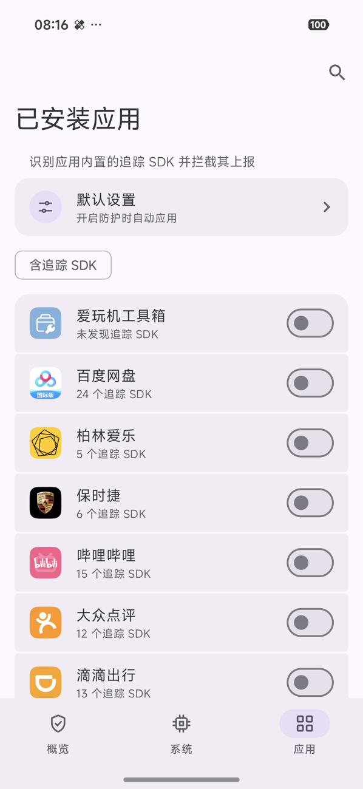

# HyperPrivacy 隐私卫士

面向小米 HyperOS 的 LSPosed 隐私与广告拦截模块，覆盖系统应用与用户安装应用，不影响厂商核心服务。

[](https://github.com/12dora/hyper-privacy/actions/workflows/ci.yml)
[](https://github.com/12dora/hyper-privacy/releases)


[](LICENSE)

基于 HyperOS 4 真机系统应用分析构建，内置 110 条规则（默认开启 97 条），覆盖 123 个系统应用，同时支持离线识别第三方应用内嵌的 210 个追踪 SDK（含 71 个广告 SDK）。应用商店、推送、云同步、查找设备、天气与系统更新等厂商服务均保持正常。模块应用本身不申请网络权限。

<p align="center">
  
  
  
  
</p>

<p align="center"><sub>主界面分为概览、系统、应用三栏，设置入口位于概览页右上角。</sub></p>

## 功能

### 系统应用防护

- **规则覆盖**：110 条内置规则覆盖 123 个系统应用，按统计分析、日志诊断、广告、设备标识、应用列表、个人数据 6 类管理。
- **默认策略**：默认开启 97 条规则，包含对通讯录、短信原文、应用列表、设备指纹与短信链接等高敏感上报通道的拦截；可能影响安全、支付、账号或定位的 13 条规则默认关闭，并注明具体影响，按需手动开启。
- **设备标识保护**：向第三方应用返回符合行业规范的全零 OAID / VAID / AAID，系统与厂商服务读取不受影响。

### 第三方应用防护

- **离线 SDK 识别**：在本地解析安装包并识别内嵌追踪 SDK（特征库涵盖 210 个 SDK，其中广告 SDK 71 个），不执行目标应用代码，不联网；支持按应用、按 SDK 单独控制与默认策略预设。针对加固后无法识别 SDK 的应用，可按应用开启「拦截全部已知追踪」。
- **按来源拦截广告 SDK**：依据请求与广告页面的代码来源执行拦截，不依赖固定域名，应对域名变更、重打包或插件化加载；隐私同意弹窗默认放行，疑似广告组件单独列出且默认不拦截。
- **按应用隐私增强**：默认开启「隔离 DRM 设备号」与「强制系统 DNS」；另提供默认关闭的「随机化硬件指纹」与「拦截原生网络请求」（使应用原生代码中的常见域名请求同样遵守域名规则），可按应用启用。
- **传感器防护**（按应用，默认关闭）：适度降低应用读到的运动、磁场、气压、光线与电池读数的精度和刷新频率，使应用难以借此推断键盘输入、通话语音、所在楼层与行动轨迹，或利用传感器出厂误差生成跨应用追踪的设备指纹；无需权限即可读取的传感器同样受保护。系统的自动亮度、屏幕旋转与电量显示不受影响，高精度测量与体感游戏等功能可能受影响。

### 系统层隐藏

以下能力在系统服务层面向第三方应用生效，不影响系统与厂商组件：

- **隐藏标识设置项与设备名**：对第三方应用隐藏系统设置中的账号、设备标识及应用列表类条目，并将自定义设备名与蓝牙名称替换为机型名称。
- **隐藏已安装应用**：按应用隐藏其他已安装的第三方应用，支持自定义保持可见的白名单及严格模式。
- **模块自隐藏**：默认对第三方应用隐藏本模块，可在「设置 → 隐私」中随时切换，即时生效。

### 日常管理

- **即时生效与一键暂停**：规则开关切换后即时作用于运行中的应用；第三方应用开启防护后，重新启动该应用即可生效。支持暂停全部拦截 15 分钟、1 小时或直至手动恢复。
- **规则健康检测与诊断**：自动识别应用更新导致的规则「已失效」「待复核」状态，对本机不存在的 SDK 标记为「不适用」；开启诊断模式可记录外连请求与拦截耗时，并导出不含个人信息的诊断报告。
- **冲突提示与配置备份**：首页自动提示功能重叠模块与重启需求；支持导出与导入规则、应用选项及外观配置（不含密钥与运行状态）。
- **零网络权限**：应用自身不申请网络权限，不收集或上传任何数据。
- **外观**：支持浅色 / 深色模式、动态取色与多套内置配色。

防护范围、保持正常的服务与数据采集方式详见 [防护范围与规则覆盖](docs/privacy-surface.md) 与 [应用如何收集隐私数据](docs/collection-techniques.md)。

## 工作原理

- **分级网络拦截**：纯上报系统应用在内核防火墙层整体断网；其余系统与第三方应用在进程内的 DNS、TLS SNI、HTTP 客户端与 WebView 层按域名或接口路径精确拦截，并阻止私有解析绕过，保留同域名下的正常服务。
- **接口与来源控制**：停用统计 SDK 的上报接口；对第三方应用中的广告 SDK 按调用来源拦截请求与广告页面；对第三方应用返回全零广告标识。
- **系统层隔离与隐藏**：在系统服务侧拦截对标识设置项、已安装应用列表及本模块的查询，并在应用进程内隔离 DRM 设备号与解析通道。
- **稳定性优先**：拦截逻辑内置异常保护，遇到异常时优先保障目标应用正常运行。

## 系统已具备的功能

HyperOS 已内置剪贴板读取提示、应用联网控制、自启动与关联启动管理、OAID 重置、模糊位置、空白通行证、应用行为记录、应用锁与应用分身。HyperPrivacy 不重复实现上述功能，专注于系统应用上报通道、第三方应用追踪 SDK 与跨应用设备关联防护。

## 方案对比

| 维度 | hosts / DNS 拦截 | 基于 VPN 的拦截方案 | 常见 Xposed 隐私模块 | **HyperPrivacy** |
|---|---|---|---|---|
| 拦截粒度 | 整域 | 整应用或整域 | 视实现而定 | 域名或接口路径，保留同域正常服务 |
| HTTPDNS / 直连 IP | 无法拦截 | 仅能按应用或 IP 拦截 | 多数无法拦截 | 支持 TLS SNI 拦截并可强制系统 DNS |
| 应用自带网络栈与内嵌网页 | 无法拦截 | 仅能按应用或域名拦截 | 多数无法拦截 | 在 HTTP 客户端与 WebView 层按路径拦截 |
| 广告 SDK 更换域名 | 需持续补充规则 | 需持续补充规则 | 视实现而定 | 按代码来源拦截，不依赖域名 |
| 占用 VPN 通道 | 部分方案占用 | 占用（与代理冲突） | 不占用 | 不占用，可与代理共存 |
| 规则取证与状态检测 | 无 | 无 | 少见 | 每条规则附分析依据，支持失效检测 |

## 安装

环境要求：HyperOS（Android 14 及以上），已获取 Root 权限并安装 LSPosed（libxposed API 101 及以上）。

1. 前往 [Releases](https://github.com/12dora/hyper-privacy/releases) 下载并安装最新 APK。
2. 在 LSPosed 中启用 HyperPrivacy，于右上角菜单选择「勾选推荐」。
3. 重启设备后打开 HyperPrivacy，确认首页显示「保护已生效」。
4. 如需保护第三方应用，在「应用」页开启对应开关，于 LSPosed 通知中确认作用域后重启该应用。

更新模块后请重启一次设备，以加载系统层变更。

## 常见问题

**是否会影响推送、云同步、支付或应用更新？**
不会。核心厂商服务以及第三方应用的推送、登录、地图等功能端点均默认保留；可能影响安全、支付、账号或定位的 13 条系统规则及敏感 SDK 默认关闭。

**为何通讯录、短信、应用列表等规则默认开启？**
此类数据敏感度较高，模块默认阻止上传并在规则详情中说明功能影响；如需使用对应辅助功能，可随时单独关闭。

**哪些操作需要重启设备？**
仅首次启用系统层功能（标识隐藏、应用列表隐藏、模块自隐藏）或更新模块后需重启一次设备。规则开关与模块自隐藏切换即时生效；第三方应用开启防护后，重新启动该应用即可。

**后续安装的小米应用如何纳入保护？**
LSPosed 不会自动勾选新装应用。在 HyperPrivacy 首页点击未防护应用提示，于 LSPosed 通知中确认并重启该应用即可。

**第三方应用商店或更新工具检测不到本模块更新？**
这是模块默认自隐藏的正常表现。如需通过第三方工具更新，可在「设置 → 隐私」临时关闭「隐藏本模块」（即时生效），或直接从 [Releases](https://github.com/12dora/hyper-privacy/releases) 下载安装。

**「已失效」「待复核」「不适用」分别代表什么？**
「已失效」表示应用更新后原拦截点失效；「待复核」表示更新后尚未重新确认；「不适用」表示本机未包含对应 SDK，属正常状态。

**是否支持其他小米机型？有哪些防护边界？**
规则仅针对本机已安装应用生效，其他 HyperOS 机型可直接使用。部分原生或自建加密网络通道、服务端关联、应用自有代码内的广告及用户主动授权的数据采集不在覆盖范围内，详见 [防护范围与规则覆盖](docs/privacy-surface.md)。

## 开发

```sh
./gradlew check                      # 静态检查、Android Lint 与单元测试
./gradlew assembleDebug              # 构建调试版本
scripts/privacy-scan.sh              # 敏感信息检查
python3 -I scripts/gen-trackers.py   # 修改特征库后重新生成 SDK 特征表
```

`core/` 包含规则目录、匹配与健康检测逻辑及单元测试；`app/` 包含 Xposed 钩子与 Jetpack Compose 界面。正式版本由 CI 自动构建签名，变更记录见 [CHANGELOG](CHANGELOG.md)。

## English

**HyperPrivacy** is an LSPosed module for Xiaomi HyperOS that blocks telemetry, ad SDKs, device-ID collection, and app-list uploads across system and user-installed apps without disrupting vendor services (app store, push, cloud sync, Find Device, weather, OTA).

- **System app protection**: 110 evidence-backed built-in rules (97 enabled by default) covering 123 system apps across six data categories, with zeroed OAID/VAID/AAID returned to third-party apps.
- **Third-party app protection**: offline scanner identifying 210 tracker SDK signatures (71 ad SDKs) with per-app and per-SDK controls, origin-based ad SDK blocking independent of domains, per-app DRM ID isolation, forced system DNS, and optional hardware-fingerprint randomization and domain blocking for native libraries.
- **Sensor protection** (per app, opt-in): coarsens motion, magnetic, barometer, light and battery readings so apps cannot easily infer keystrokes, speech, floor level or movement, or fingerprint the device from sensor calibration errors.
- **System-level hiding**: hides identifier-bearing system settings, custom device names, installed app lists (per app), and the module itself from third-party apps.
- **Layered enforcement with stability safeguards**: combines kernel firewall for pure-telemetry system apps, DNS, TLS SNI, path-level HTTP/WebView hooks, and SDK method no-ops. Uses no VPN slot and requests no network permission in the app itself.
- **Requirements**: HyperOS (Android 14+), root with LSPosed (libxposed API 101+). One reboot is required after install or update for system-level features; rule switches apply immediately, and per-app protection takes effect after the app restarts.

HyperOS built-in privacy controls (clipboard prompts, network control, auto-start management, OAID reset, approximate location, blank-info pass, behavior records, app lock / dual apps) are intentionally not duplicated.

Keywords: HyperOS privacy, MIUI telemetry blocker, Xiaomi ad blocker, OneTrack, system ads, LSPosed module, Xposed privacy, tracker SDK blocker.

## 贡献者

<table>
  <tr>
    <td align="center"><br><b>Opus 5.5</b></td>
    <td align="center"><br><b>Mythos 5.2</b></td>
    <td align="center"><br><b>Gemini 4 Neon</b></td>
    <td align="center"><br><b>Grok 4.6</b></td>
  </tr>
</table>

Mythos 5.2 参与了红蓝对抗演练，以攻击方视角评估防护边界并协助完善薄弱环节。

## 许可证

[MIT](LICENSE)
