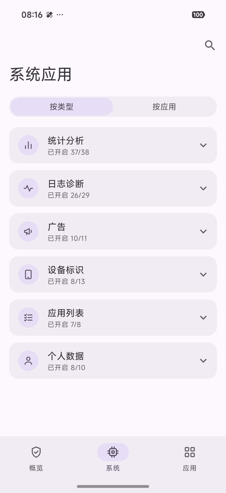

# HyperPrivacy

**给小米 HyperOS 做的隐私上报与广告屏蔽模块（LSPosed）。只拦隐私上报和广告，不影响任何厂商服务。**

[](https://github.com/12dora/hyper-privacy/actions/workflows/ci.yml)
[](https://github.com/12dora/hyper-privacy/releases)


[](LICENSE)

在设置里关掉「用户体验计划」，系统应用就停止上报了吗？并没有。HyperPrivacy 在一台 HyperOS 4 真机上把 318 个系统应用挨个排查了一遍，将能找到的统计、日志、广告、设备标识和应用列表上报通道整理成 102 条规则，帮你一键拦住。而日常离不开的应用商店、推送、云同步、查找设备、天气和系统更新，全部照常工作。

<p align="center">
  
  
  
  
</p>

## 为什么需要它

在真机上做完一轮抓包和反编译之后，我们看到了这些实际情况：

- **系统开关并不是真正的隐私边界。** 明明已经关掉了「用户体验计划」和「个性化广告」，系统分析服务还是会连接统计服务器、快手广告和夸克，甚至在后台读取精确位置。
- **102 个系统应用里都内置了 OneTrack 统计 SDK。** 它的上报地址被编码成字节数组藏了起来，普通的域名扫描根本查不到。它还会上传已安装应用列表，新版本甚至多了一条经 Google Pub/Sub 的原生上报通道。
- **负一屏会上传完整的应用列表。** 手机里每个应用的包名、版本和安装时间都会被上传；之后每次安装或卸载应用，它也会跟着增量上报。
- **系统输入法塞进了多套第三方统计。** 腾讯 qimei 设备指纹、Bugly、灯塔、百度统计等都在里面，平时打字的时候就在上报。
- **正常服务和隐私上报常常混在同一个服务器上。** 比如安全中心的同一个域名，既承载正常的隐私授权，也负责月度数据上传。如果按域名一刀切，正常服务也会误伤，所以必须精确到接口路径来区分。

如果你对具体的排查方法、取证依据和覆盖情况感兴趣，可以查看 [隐私上报面与规则覆盖](docs/privacy-surface.md)。

## 功能

- **102 条规则，覆盖 120 个系统应用**：按用途整理为统计分析、日志诊断、广告、设备标识、应用列表、个人数据 6 类，一目了然。
- **默认配置足够省心**：102 条规则里 90 条默认开启，装好即用。其中通讯录、短信原文、应用列表、设备指纹、短信链接这类高风险泄露，即使拦截会带来一点副作用也默认阻止，并在规则里写明影响；另外 12 条拦了会影响安全、支付、账号、定位等功能的规则默认关闭，需要时可以手动开启。
- **隐藏设备标识**：第三方应用读取 OAID / VAID / AAID 时只会拿到全零结果（符合 MSA 规范的「限制广告追踪」值），小米自家服务不受影响。
- **规则健康检测**：系统更新后如果厂商改了接口，会自动提示「已失效」「待复核」或「长期无拦截」；在其他机型上本来就不存在的 SDK 会显示为「不适用」，不会误报。
- **诊断模式**：记录系统应用的网络请求，标出疑似新的上报通道；支持一键导出不含个人信息的诊断报告，方便反馈。
- **即时生效**：切换开关后立刻作用于正在运行的应用，不需要为了试一条规则反复重启。
- **自身零联网权限**：应用本身没有申请联网权限，不收集、也不上传任何数据。
- **顺眼的外观设计**：支持浅色、深色模式与跟随系统，提供动态取色与 5 套内置配色。

## 与其他方案的对比

平时大家可能会用 hosts、VPN 防火墙或其他模块来拦广告和上报。不同方案各有取舍，这里放在一起供你参考：

| | hosts / DNS 拦截 | VPN 防火墙 | 常见 Xposed 隐私模块 | **HyperPrivacy** |
|---|---|---|---|---|
| 拦截精度 | 整个域名 | 整个应用 | 视实现而定 | 精确到域名或接口路径，同一服务器上的服务照常工作 |
| HTTPDNS / 写死 IP 直连 | 拦不住 | 只能给整个应用断网 | 多数拦不住 | 按 TLS 握手中的域名（SNI）拦截 |
| 应用自带网络栈（Cronet、内嵌网页） | 拦不住 | 只能给整个应用断网 | 多数拦不住 | 在 HTTP 客户端层与 WebView 请求层拦截 |
| 原生代码直接联网 | 部分可拦 | 可拦 | 拦不住 | 纯上报应用由内核防火墙按 uid 直接断网 |
| 占用 VPN 通道 | 部分方案占用 | 占用，会与代理冲突 | 不占用 | 不占用，可与代理工具共存 |
| 运行时需要 root | 视方案而定 | 不需要 | 常常需要 | 不需要，只需 LSPosed |
| 配置是否暴露给其他应用 | — | — | 有的写进全局设置，任何应用可读 | 经 LSPosed 私有通道传递，不外泄 |
| 每条规则有取证依据 | 否 | 否 | 少见 | 是，附抓包、反编译或 dex 证据 |
| 接口变化能否察觉 | 否 | 否 | 否 | 支持规则健康检测 |

## 工作原理

每条规则都对应一个具体的上报通道。HyperPrivacy 会根据通道特点，选用最精确、也不会误伤正常服务的拦截层：

| 拦截层 | 作用位置 | 用途 |
|---|---|---|
| 内核防火墙 | system_server | 对拥有独立 uid 的纯上报应用（系统分析服务、系统广告服务）整体断网，原生代码也无法绕过 |
| DNS 解析 | 目标应用进程 | 拦住上报域名的解析请求 |
| TLS 握手 | 目标应用进程 | 按握手时的域名（SNI）拦截，覆盖 HTTPDNS 和写死 IP 的直连 |
| HTTP 客户端 | 目标应用进程 | 按「域名 + 路径」精准拦截，覆盖 HttpURLConnection、OkHttp、Cronet 与内嵌网页 |
| SDK 方法 | 目标应用进程 | 直接停用统计 SDK 的上报接口 |
| 设备标识 | 安全中心进程 | 向第三方应用返回全零的 OAID / VAID / AAID |

所有拦截都遵循「失败即放行」原则：万一模块自身出错，也只会默认放行，目标应用照常运行，不会因此崩溃。

## 安装

整个配置过程很简单，只需四步：

1. **准备环境**：确保系统为 HyperOS（Android 14 及以上），并已安装 LSPosed（libxposed API 101 及以上，如 LSPosed 2.x）。
2. **安装模块**：前往 [Releases](https://github.com/12dora/hyper-privacy/releases) 下载最新的 APK 并安装。
3. **勾选作用域**：打开 LSPosed，启用 HyperPrivacy，在模块页右上角菜单中选择「勾选推荐」。
4. **重启生效**：重启手机后打开 HyperPrivacy，看到「保护已生效」就说明已经在工作了。

## 常见问题

**之后才安装的小米应用（如米家、小米健康）也会被保护吗？**
会，但需要你点一下。LSPosed 不会自动把新装的应用加入作用域，HyperPrivacy 首页会提示「N 个应用未启用防护」，点「启用」后在 LSPosed 的通知里确认即可；应用重新启动后生效。规则列表只显示本机已安装应用相关的规则。

**会影响推送、云同步、应用更新吗？**
放心，不会。账号、推送、云服务、系统与应用更新、天气、定位查询、云输入这些日常服务的端点都不在拦截范围内，排查文档里也逐项列出了保留的服务。

**为什么有些规则默认关闭？**
现在默认关闭的只剩 12 条。它们和具体功能共用接口，拦掉之后会影响安全、支付、账号或定位，比如云查杀需要上传应用特征，支付收银台、查找设备的定位也可能受牵连；还有几条是你主动参与的项目，比如问题反馈和地震监测志愿者。所以我们把它们默认关上，并在规则里写明影响，把选择权交给你。

**拦掉通讯录、短信这类数据，会不会也有副作用？**
会有一点，所以每条规则都写明了影响，比如「云端通讯录词库失效」「无法提交流量纠错」。但这类数据泄露的代价更大，所以我们选择默认阻止；觉得影响不划算，随时可以在规则详情里单独关掉。

**提示「已失效」「待复核」「不适用」是什么意思？**
- 「已失效」：这条规则之前在本机生效过，现在找不到拦截点了，通常是应用更新后厂商改了接口。
- 「待复核」：应用更新后，这条规则还没有重新确认状态。
- 「不适用」：本机的这个应用里本来就没有对应的 SDK，属于正常情况，不用担心。

**换一台小米手机能用吗？**
可以。模块只会作用于本机已安装的应用；不存在的 SDK 会安静地显示为「不适用」，不会报错。也很欢迎你用诊断模式导出一份报告，帮我们一起补充更多机型的规则。

**为什么不直接用 hosts 或 DNS 拦截？**
一方面，很多上报和正常服务共用同一个域名，按域名拦截很容易误伤服务；另一方面，不少系统应用直接走 HTTPDNS 或自带网络栈，根本不经过系统 DNS，传统方式拦不住。

## 开发

如果你想自己编译验证，或者参与改进，常用命令都在这里：

```sh
./gradlew check            # detekt、Android Lint（警告即错误）、单元测试
./gradlew assembleDebug
scripts/privacy-scan.sh    # 防止仓库中出现本机路径、主机名、个人邮箱等信息
```

代码结构与工程约定：

- `core/`：规则目录、匹配器、健康检测等纯 Kotlin 逻辑，全部配有单元测试。
- `app/`：Xposed 钩子层与 Jetpack Compose 界面。
- 为了让界面保持简明易读，规则文案受门禁约束：标题不超过 10 字，描述不超过 14 字，同一分类下标题不重复。
- 正式版由 CI 构建并签名，签名密钥只存放在 GitHub Secrets 中。

## English

Turning off Xiaomi's "User Experience Program" doesn't stop system apps from reporting back. **HyperPrivacy** is an LSPosed module for Xiaomi HyperOS that blocks system telemetry, ad SDKs, device-ID collection, and installed-app-list uploads — without breaking any of the vendor services you rely on (app store, push, cloud sync, Find Device, weather, OTA).

- **Grounded in real-device evidence**: 100 evidence-backed rules covering 120 system apps, built from a full traffic and dex survey of a HyperOS 4 device.
- **Six precise enforcement layers**: kernel firewall per uid, DNS, TLS SNI (defeats HTTPDNS and hard-coded IPs), HTTP client and WebView (path-level, so services sharing the same host keep working), SDK method no-op, and zeroed OAID/VAID/AAID for third-party apps.
- **Stays reliable across updates**: rule health detection flags rules broken by vendor updates, while diagnostics mode helps discover new reporting channels.
- **Lightweight and private**: uses no VPN slot, needs no root at runtime, and requests no network permission in the app itself. Rule changes apply right away without a reboot.

Keywords: HyperOS privacy, MIUI telemetry blocker, Xiaomi ad blocker, OneTrack, MSA ads, LSPosed module, Xposed privacy.

## 贡献者

<table>
  <tr>
    <td align="center"><br><b>Opus 5.5</b></td>
    <td align="center"><br><b>Gemini 4 Neon</b></td>
    <td align="center"><br><b>Grok 4.6</b></td>
  </tr>
</table>

<sub>头像图标来自 LobeHub Icons（MIT），商标归各自所有者。</sub>

## 许可证

[MIT](LICENSE)
